### Hi there, I'm Harkirat 👋

#### 🚀 Full-Stack Developer focused on building scalable, real-time web systems

I build production-oriented applications with clean architecture, real-time communication, and performance-focused backend design.  
I enjoy working close to the product and shipping features end-to-end.

---

### 🧠 Technical Focus

     

Explore my technical focus

- 🔧 **Backend Engineering**
  - RESTful and event-driven APIs
  - Authentication & authorization systems
  - Modular backend architecture

- 🤖 **AI Engineering**
  - LLM integration and AI-powered applications
  - Tool calling and agent workflows
  - Structured outputs and response validation

- ⚡ **Real-Time Systems**
  - WebSockets for bi-directionalcommunication
  - WebRTC for peer-to-peer media streaming
  - Signaling server design

- 🏗️ **System Design**
  - Scalable service-oriented architecture
  - Separation of concerns
  - API versioning & maintainability

- 🔁 **Developer Workflow**
  - Git-based collaboration
  - Clean commit history
  - Feature-based development
 
- ⚛️ **Frontend Engineering**
  - Component-driven architecture
  - State management & performance optimization
  - Responsive and accessible UI systems

---

### 🛠️ What I’m currently doing
- Building real-time communication platforms
- Strengthening backend architecture & scalability
- Working with production-style codebases
- Open to **remote internships and early-stage startup collaboration**

---

### 📌 Selected Work
Explore pinned repositories below —  

---

### 📊 GitHub Stats

---

### 📫 Contact

💡 *Build systems. Ship value. Learn fast.*
